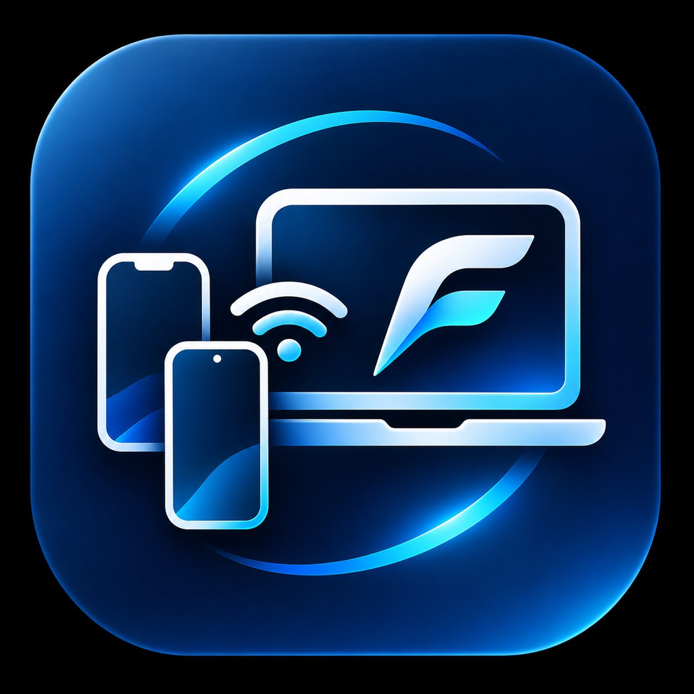
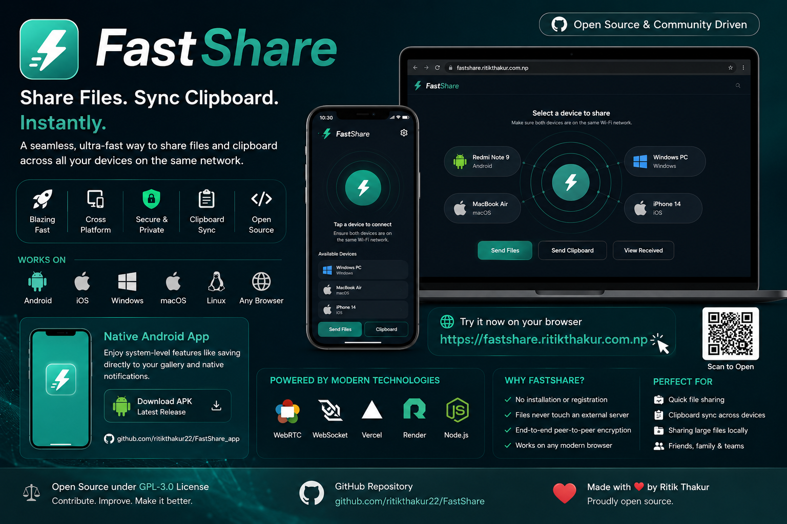
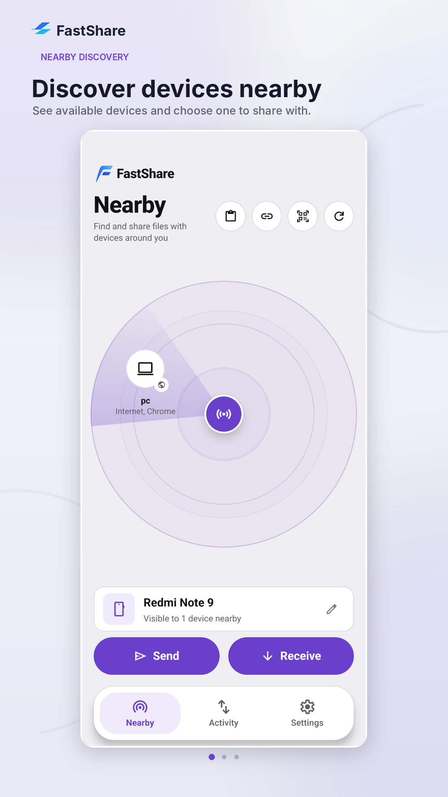
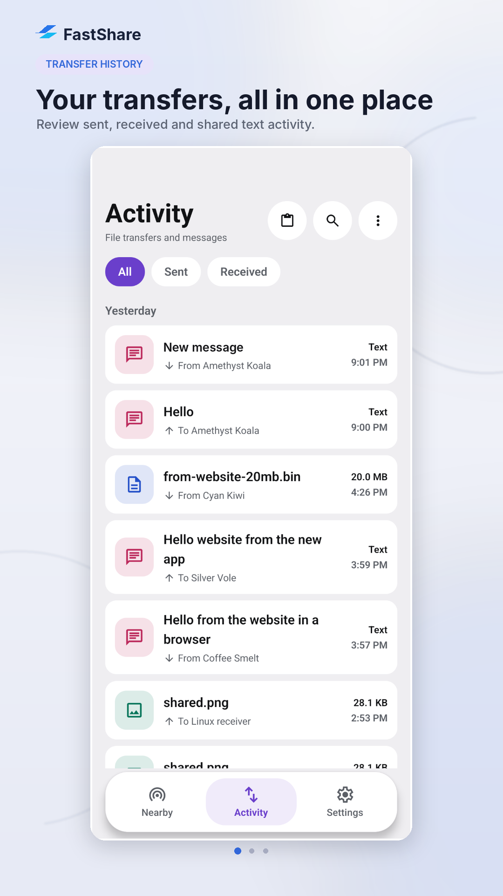
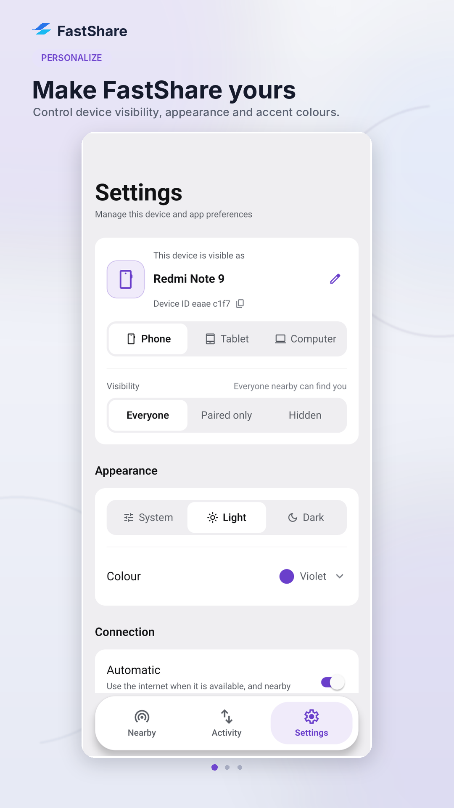
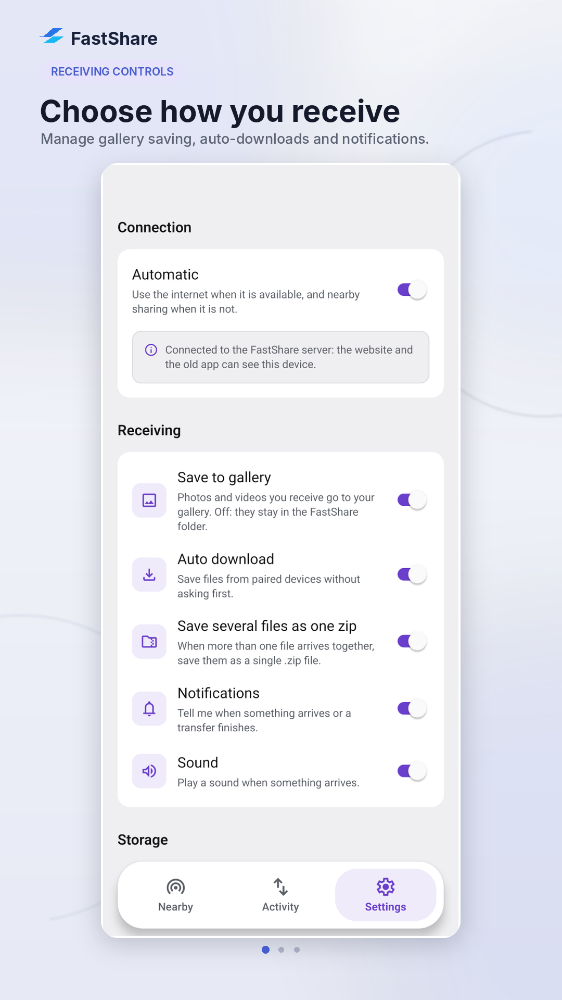
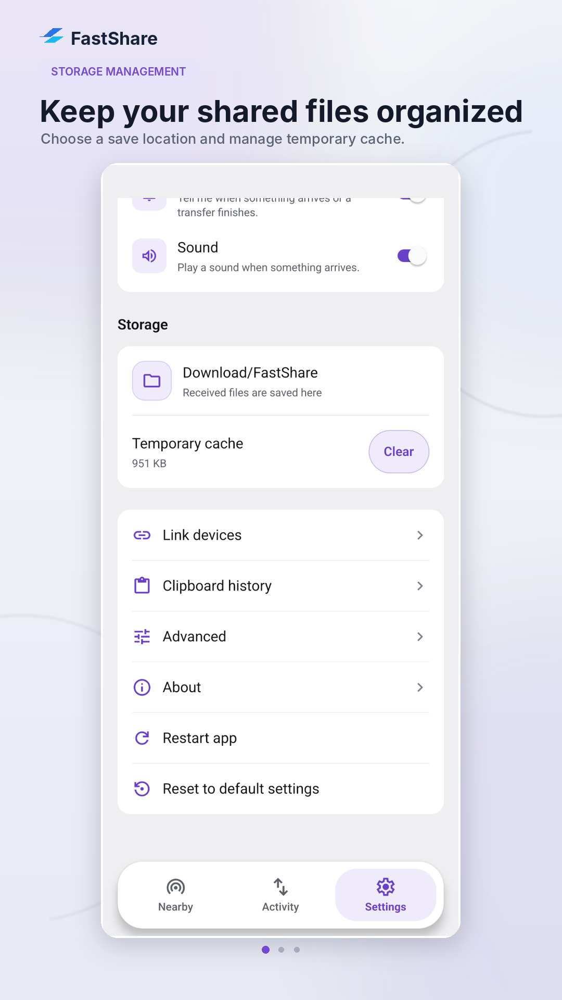
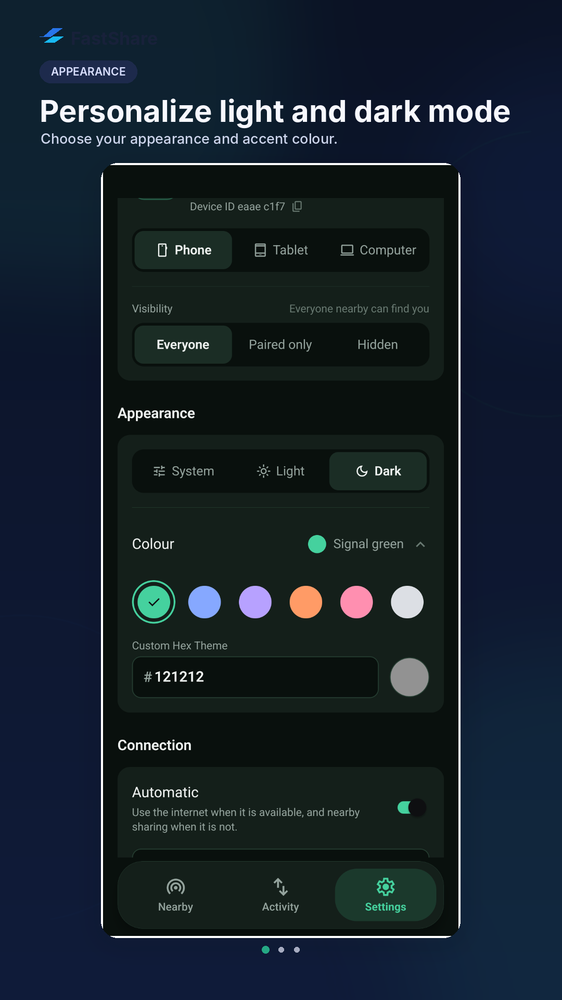
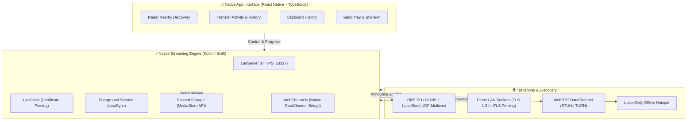

# FastShare 2.0

  

<h3 align="center">Fast, private, zero-cloud file, text, and clipboard sharing across Android, iOS, and Web.</h3>

  
  
  
  
  
  

---

## About FastShare 2.0

**FastShare 2.0** is a native peer-to-peer data transfer application built from the ground up to replace slow cloud uploads, cumbersome pairing steps, and platform-locked sharing tools.

* **Zero Cloud Storage**: Files and text travel directly between device network sockets. Nothing is uploaded to or stored on third-party servers.
* **Native Byte-Streaming**: Native Kotlin (Android) and Swift (iOS) engines stream data straight between sockets and storage (`MediaStore` / `Documents`), keeping memory usage flat even for multi-gigabyte transfers.
* **LocalSend Compatibility**: Fully interoperable with LocalSend devices on the same Wi-Fi using the LocalSend v2.2 HTTPS protocol on port `53317`.
* **Zero-Install Web Sharing**: Works seamlessly with desktop and mobile browsers via the [FastShare Web Client](https://fastshare.ritikthakur.com.np) using WebRTC DataChannels.
* **Offline Local Hotspot**: Spin up a local-only Wi-Fi hotspot with one-scan QR auto-connect when no router is available.

---

## Download & Install

* **Google Play Store (Android):** [Install FastShare](https://play.google.com/store/apps/details?id=com.crdy.fastshare)
* **Direct Releases (Android APK & iOS Unsigned IPA):** [GitHub Releases](https://github.com/ritikthakur22/fastshare_app/releases)
* **Web Client (Windows / macOS / Linux / Mobile Browser):** [fastshare.ritikthakur.com.np](https://fastshare.ritikthakur.com.np)

---

## Documentation & Guides

| Document | Description |
|---|---|
| [CHANGELOG.md](CHANGELOG.md) | Release history and version notes (`v2.0.0` – `v2.0.2`) |
| [FAQ.md](FAQ.md) | iOS `.ipa` sideloading steps, LocalSend setup, and Offline Hotspot guide |
| [docs/PROTOCOL.md](docs/PROTOCOL.md) | High-level overview of LAN (mTLS / LocalSend v2.2) & WebRTC protocols |
| [SECURITY.md](SECURITY.md) | Encryption model, threat mitigations, and vulnerability reporting |
| [PRIVACY.md](PRIVACY.md) | Zero-tracking privacy policy and app permissions breakdown |

---

## App Showcase

  

  
  
  

  
  
  

---

## Architecture & How It Works

### Transfer Lifecycle
1. **Discovery**: Devices advertise and discover each other via Bonjour/DNS-SD (`_fastshare._tcp` and `_localsend._tcp`) and UDP multicast broadcast on port `53317`. Dual-reachable devices merge cleanly on the radar with a `[ Wi-Fi (Fast direct) | Internet ]` route selector.
2. **Control Negotiation**: The sender transmits file metadata (`fileName`, `fileType`, `size`) via HTTPS `POST /api/localsend/v2/prepare-upload`.
3. **Acceptance & Validation**: The receiver validates storage availability and previews incoming files and photos before accepting.
4. **Direct Stream**: Native Kotlin/Swift opens an encrypted TLS 1.3 stream directly into device storage, reporting live progress without buffering chunks in JavaScript memory.
5. **Foreground Service**: Android keeps transfers reliable in the background via a `dataSync` Foreground Service with live notification progress.

---

## Core Features

| Feature | Description |
|---|---|
| **Nearby Radar** | Real-time discovery radar finding phones, tablets, and computers on Wi-Fi, hotspot, or WebRTC. |
| **mTLS LAN Pairing** | Cryptographic mutual TLS pairing with 6-digit SAS verification codes and QR codes. |
| **Auto-Download** | Automatically accept and save files from trusted, paired devices without prompting. |
| **Gallery Integration** | Automatically indexes received photos and videos into the system Gallery (`Pictures/FastShare`). |
| **Auto-Zip Bundling** | Compresses multiple incoming files into a single `.zip` archive on device upon request. |
| **Auto-Copy Text** | Copies received text clips straight to the system clipboard when FastShare is open. |
| **Offline Local Hotspot** | Generate a standalone Wi-Fi hotspot and QR code with one-scan auto-connect when no router is available. |
| **Resilience & Retry** | Automatic exponential backoff retries and resumable LAN transfers for transient Wi-Fi drops. |

---

## Interoperability Matrix

| Remote Peer | Protocol Used | Encryption | Speed Target |
|---|---|---|---|
| **FastShare App (Android / iOS)** | FastShare LAN Extensions | mTLS 1.3 (P-256) | 25 – 80+ MB/s |
| **LocalSend (Desktop / Mobile)** | LocalSend v2.2 (HTTPS :53317) | TLS 1.3 Pinning | 25 – 80+ MB/s |
| **FastShare Web Client (Browser)** | WebRTC DataChannels | DTLS-SRTP / SCTP | 5 – 25 MB/s |
| **Offline Guest (No Router)** | Local-Only Hotspot | WPA2-PSK Direct | 15 – 35 MB/s |

---

## License & Source Code

**Copyright © 2026 Ritik Thakur. All Rights Reserved.**

FastShare's source code is maintained privately by **Ritik Thakur**. This repository serves as the public showcase, documentation, and official release distribution hub.

Unauthorized copying, distribution, modification, reverse engineering, decompilation, public display, or publication of this software, its assets, UI design, or trademarked branding is strictly prohibited without the express prior written authorization of the copyright holder. See [LICENSE](LICENSE) for full terms.
